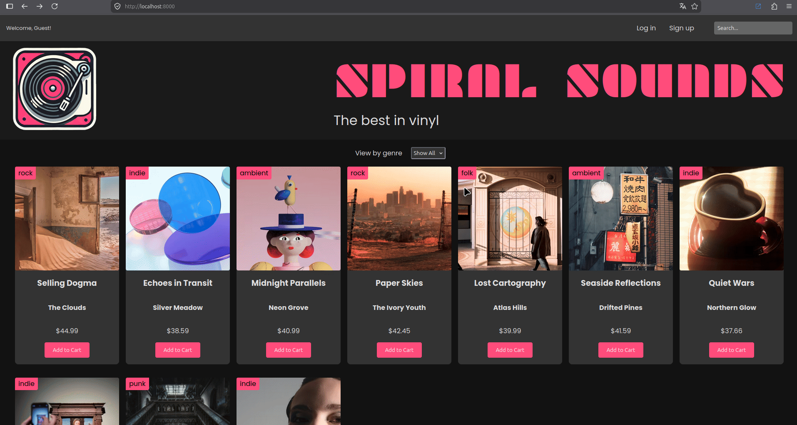

# 🎵 Spiral Sounds

**Online classic vinyl store** (Loja online de discos de vinil clássicos). 



O Spiral Sounds é uma aplicação backend construída para gerenciar uma loja virtual de vinis. O projeto foca em um sistema de autenticação robusto e seguro, além do gerenciamento completo de carrinho de compras e catálogo de produtos. A aplicação utiliza sessões persistentes para manter os usuários logados, criptografia para proteger as senhas no banco de dados e middlewares para proteger o acesso a rotas privadas.

## 🎓 Sobre o Projeto e Aprendizados

Este projeto foi desenvolvido como parte do curso [The Backend Developer Path](https://scrimba.com/the-backend-developer-path-c0tbi0l98f) da plataforma **Scrimba**.

**O maior desafio durante o desenvolvimento:**
A parte mais desafiadora foi orquestrar perfeitamente o fluxo de autenticação e a segurança das rotas. Integrar o `express-session` para manter o estado de login do usuário de forma segura exigiu bastante atenção aos detalhes. Além disso, a criação de um middleware personalizado (`requireAuth`) para interceptar requisições e proteger as rotas do carrinho, barrando usuários não autenticados (HTTP 401 Unauthorized), foi um excelente exercício prático de segurança e controle de fluxo no Express. 

## 🚀 Tecnologias e Bibliotecas

Este projeto foi desenvolvido utilizando **JavaScript (ES Modules)** e as seguintes tecnologias:

* **[Node.js](https://nodejs.org/)** - Ambiente de execução.
* **[Express](https://expressjs.com/)** - Framework web para gerenciamento de rotas, requisições HTTP e middlewares.
* **[SQLite](https://sqlite.org/)** & **[sqlite3](https://www.npmjs.com/package/sqlite3)** - Banco de dados relacional leve e embutido.
* **[express-session](https://www.npmjs.com/package/express-session)** - Gerenciamento de sessões de usuário.
* **[bcryptjs](https://www.npmjs.com/package/bcryptjs)** - Criptografia (hashing) de senhas.
* **[validator](https://www.npmjs.com/package/validator)** - Validação de dados de entrada.
* **[dotenv](https://www.npmjs.com/package/dotenv)** - Gerenciamento de variáveis de ambiente.

## 🗂 Arquitetura do Projeto

A aplicação segue uma arquitetura limpa e modular:

* `controllers/`: Lida com a lógica de requisição/resposta (ex: `authController`, `cartControllers`).
* `middlewares/`: Interceptadores de requisição, como o `requireAuth` para proteção de rotas privadas.
* `routes/`: Define os endpoints da API e os conecta aos respectivos controladores e middlewares.
* `services/`: Contém a regra de negócio da aplicação.
* `database/`: Configuração e conexão com o banco de dados SQLite.
* `public/`: Arquivos estáticos servidos pelo Express (HTML, CSS e JS do front-end).
* `server.js`: Ponto de entrada da aplicação.

## 📡 Rotas da API

Abaixo estão os principais endpoints disponíveis na aplicação. *(Nota: as rotas assumem que os routers foram montados com seus respectivos prefixos no `server.js`)*.

### 🔐 Autenticação (`/auth`)
| Método | Rota | Descrição |
| :--- | :--- | :--- |
| `POST` | `/register` | Cria uma nova conta de usuário. |
| `POST` | `/login` | Autentica o usuário e inicia a sessão. |
| `GET` | `/logout` | Encerra a sessão do usuário atual. |

### 👤 Usuário (`/me`)
| Método | Rota | Descrição |
| :--- | :--- | :--- |
| `GET` | `/` | Retorna os dados do usuário atualmente autenticado na sessão. |

### 💿 Produtos (`/products`)
| Método | Rota | Descrição |
| :--- | :--- | :--- |
| `GET` | `/` | Retorna a lista de todos os discos de vinil disponíveis. |
| `GET` | `/genres` | Retorna a lista de gêneros musicais cadastrados. |

### 🛒 Carrinho (`/cart`)
*🔒 **Atenção:** Todas as rotas abaixo são protegidas pelo middleware `requireAuth` e exigem uma sessão ativa.*

| Método | Rota | Descrição |
| :--- | :--- | :--- |
| `GET` | `/` | Retorna todos os itens atuais no carrinho do usuário. |
| `POST` | `/add` | Adiciona um novo disco de vinil ao carrinho. |
| `GET` | `/cart-count` | Retorna a quantidade total de itens no carrinho. |
| `DELETE`| `/:itemId` | Remove um item específico do carrinho pelo seu ID. |
| `DELETE`| `/all` | Esvazia completamente o carrinho. |

## ⚙️ Como executar o projeto localmente

### Pré-requisitos
* [Node.js](https://nodejs.org/en/) (versão 18+ recomendada).
* Git.

### Passo a passo

1. **Clone o repositório:**
   ```bash
   git clone [https://github.com/obrnocsta/authentication.git](https://github.com/obrnocsta/authentication.git)
````

2.  **Acesse a pasta do projeto:**

    ```bash
    cd authentication
    ```

3.  **Instale as dependências:**

    ```bash
    npm install
    ```

4.  **Configuração das Variáveis de Ambiente:**
    Crie um arquivo `.env` na raiz do projeto baseado no `.env.example` e preencha com as suas informações:

    ```bash
    cp .env.example .env
    ```

      * **`PORT`**: A porta onde o servidor será executado (ex: `3000`).
      * **`SECRET_SESSION_KEY`**: Uma string segura e aleatória para assinar a sessão do usuário.

5.  **Inicie o servidor (Modo Desenvolvimento):**

    ```bash
    npm start
    ```

    *O projeto utiliza a flag nativa `--watch` do Node.js, então qualquer alteração no código reiniciará o servidor automaticamente.*

## ✍️ Autor

**Bruno Costa** - [GitHub](https://www.google.com/search?q=https://github.com/obrnocsta)

## 📝 Licença

Este projeto está sob a licença **ISC**.
